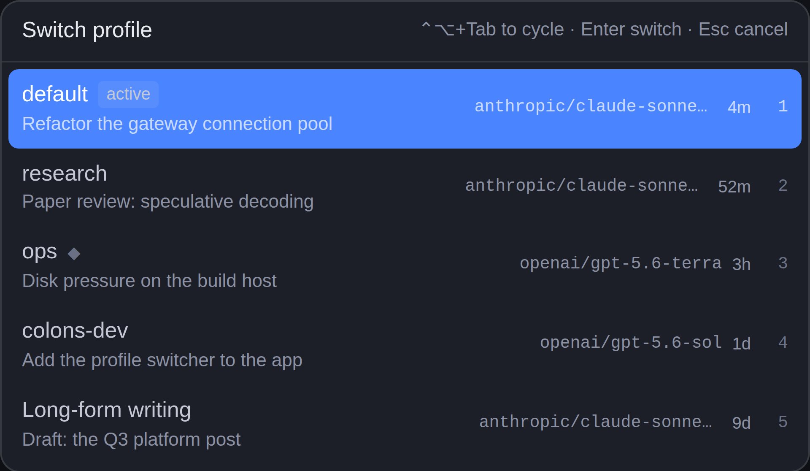

# Profile Switcher — Hermes Desktop plugin

A macOS-style quick switcher for [Hermes](https://hermes-agent.nousresearch.com)
profiles, in the Hermes Desktop app.

Hermes already ships positional profile hotkeys (⌘1…⌘9 for the first nine
profiles, ⌘⌥1…⌘⌥9 for the rest) — but there is no way to *browse* your
profiles and jump to one, and no chord at all for "switch profile". This plugin
adds that missing surface: one key opens a panel of every profile, you move the
highlight, and you land in the one you pick.



## What it does

- **Alt+Tab for profiles.** Hold **⌃⌥** and tap **Tab** to cycle through your
  profiles, then let go to land on the highlighted one — the same
  hold-tap-release rhythm as the OS app switcher.

  > **Why not literal Alt+Tab?** The operating system owns Alt+Tab (and Win+Tab,
  > and ⌘Tab). Those keystrokes are consumed by the window manager before any
  > application sees them, so *no* app — Electron apps included — can bind
  > them. ⌃⌥+Tab is the closest chord the OS leaves to applications, and
  > nothing in Hermes core claims it.

- **One chord opens the switcher.** ⌥⌘P by default (⌃⌥P on Linux/Windows).
  It is a *contributed* keybind, so it shows up in the app's own **Keybind
  panel** — rebind it, or clear it, like any other shortcut.
- **Every profile, with context.** Each row shows the profile name, the model
  it runs, how long ago it was last active, and the title of its most recent
  conversation. A profile with a worker running shows a spinner.
- **Keyboard-driven.** Hold ⌃⌥ and tap Tab (or ↑ ↓) to move, Enter switches,
  Esc cancels. The first tap moves you *off* the profile you are already in,
  exactly like Alt+Tab, so you are switching rather than re-selecting.
- **A status-bar chip** names the active profile and opens the same panel on
  click — a second, discoverable door for people who never learn the chord.
- **The switch is a real switch.** It goes through the Desktop's own profile
  path: the target profile's backend is activated, the chrome is scoped onto
  it, and you land in that profile's most recent conversation (or a fresh
  draft, if it has none).

## Install

From the Hermes plugin catalog (Hermes Desktop → **Capabilities → Plugins**,
search *Profile Switcher*), or from a terminal:

```bash
hermes plugins install profile-switcher
```

The app copies the desktop half into `~/.hermes/desktop-plugins/` and loads it
within a few seconds. Flip the switch in **Capabilities → Plugins** to enable
it — the plugin ships **off by default**, so it never claims a chord you did
not ask for.

To install from this repository directly:

```bash
hermes plugins install okyssta/hermes-profile-switcher
```

Or paste `https://github.com/okyssta/hermes-profile-switcher` into Hermes
Desktop → **Capabilities → Plugins → Install from source**. The plugin lives at
the repository root (`plugin.yaml` + `desktop/plugin.js`), which is what both
installers scan for.

## Settings

**Settings → Plugins → Profile Switcher** has two toggles: whether each row
shows the profile's model, and whether it shows the last conversation title.
They are stored per plugin through the SDK's own storage door.

## Requirements

Hermes Desktop 0.21.6 or newer (the floor for the floating-pane placement, the
contributed-keybind area, and the cross-profile switch this plugin is built
on). The plugin is desktop-only — it registers nothing on the agent side, so
it does nothing in the CLI or on a messaging platform.

## Disclosure

- **Network calls:** none beyond the Hermes gateway the Desktop app is already
  connected to. The plugin issues one `profiles.list` read when the switcher
  opens; it never polls on a timer.
- **Reads outside its own data:** none. It reads the profile roster the
  gateway already serves to the app's own profile rail.
- **Shell commands:** none.
- **Long-running background processes:** none.
- **Stored credentials:** none. The only persisted state is two booleans in
  the plugin's own scoped storage.
- **Telemetry:** none.

## Layout

```
plugin.yaml                     ← manifest
__init__.py                     ← the no-op agent half the loader requires
desktop/plugin.js               ← the loadable artifact: plain ESM, built
src/                            ← the TSX source it is built from
  plugin.tsx
  roster.ts                     ← the pure roster helpers (unit-tested)
  sdk.d.ts                      ← ambient types for the plugin SDK
tests/                          ← unit tests + a load-and-register harness
```

The plugin is at the repository ROOT, not in a subdirectory: the Desktop app's
"Install from source" dialog only scans the repo root for `plugin.js` or
`desktop/plugin.js`, and `hermes plugins install <owner>/<repo>` resolves the
same way.

## Build

```bash
npm install
npm run build     # esbuild → profile-switcher/desktop/plugin.js
npm run check     # tsc --noEmit
npm test          # unit tests + the load-and-register harness
```

`desktop/plugin.js` is committed, so installing from a checkout never needs a
build step.

## Development notes

The desktop half is plain ESM loaded **uncompiled** by the app, and the only
importable specifiers are `@hermes/plugin-sdk`, `react`, and
`react/jsx-runtime`. The build output is checked in, so the repository has no
runtime dependency on npm.

The `tests/plugin-harness.test.mjs` harness stands in for the Electron app on
a headless host: it loads the built bundle the way the renderer's loader
does, calls `register(ctx)` against a recording context, and renders every
contributed component with React's server renderer. It proves the plugin
loads, registers, and renders — it does **not** prove the real Electron
render, the real keybind dispatch, or a live profile switch. Those need the
app.

## License

MIT
